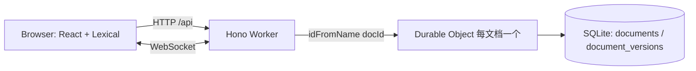

# Editor

基于 Cloudflare Workers 的富文本编辑器：React + Lexical 负责编辑，Hono 提供 HTTP/WebSocket 入口，Durable Object 内置 SQLite 负责文档与**多版本**持久化。

## 技术栈

| 层 | 选型 |
| --- | --- |
| 运行时 | Cloudflare Workers（`workerd`）、Durable Objects（SQLite 存储） |
| 服务端 | Hono、`vite-ssr-components`（注入 Vite 资源） |
| 客户端 | React 19、Lexical |
| 构建 | Vite 8 + `@cloudflare/vite-plugin`、Tailwind CSS 4、shadcn/base-ui |
| 类型 | `wrangler types` 生成 `Env` 与 Worker 运行时类型 |

## 快速开始

```txt
npm install
npm run dev
```

```txt
npm run build
npm run preview
npm run deploy
```

修改 `wrangler.jsonc` 后重新生成类型：

```txt
npm run cf-typegen
```

## 当前目录

```txt
src/
  client/
    app.tsx                 # React 入口
    Editor.tsx              # 现有 WebSocket demo（后续替换为 Lexical）
    components/ui/button.tsx
    lib/utils.ts
  server/
    index.tsx               # Hono 入口 + React SSR
    renderer.tsx            # Hono jsxRenderer（待清理，见步骤 0）
    EditorServerDurable.ts  # Durable Object（WebSocket echo demo）
    style.css
vite.config.ts
wrangler.jsonc
```

`wrangler.jsonc` 已经声明了 SQLite 存储的 Durable Object：

```jsonc
"durable_objects": {
  "bindings": [{ "name": "EDITOR_SERVER_DURABLE", "class_name": "EditorServerDurable" }]
},
"exports": {
  "EditorServerDurable": { "type": "durable-object", "storage": "sqlite" }
}
```

## 目标

1. 用 Lexical 实现富文本编辑（标题、列表、引用、代码、链接、表格等）。
2. 每次保存生成一个**不可变版本**，可浏览、预览、回滚。
3. 文档与版本写入 Durable Object 的 SQLite，而不是 KV。
4. 保持版本写入的原子性与并发安全（避免后写覆盖先写）。
5. （可选）通过 Durable Object WebSocket 向同文档的其他客户端广播新版本。

## 架构



一个文档对应一个 Durable Object 实例（DO 名称 = `docId`），因此该文档的所有版本读写天然串行化；跨文档互不阻塞。

## 实施步骤

### 步骤 0：先修复现有骨架问题

这些问题不解决，后续编辑器代码会被无关报错干扰：

- [ ] **统一 JSX 运行时。** `src/server/renderer.tsx` 使用 Hono 的 `jsxRenderer`，其 JSX 类型是 Hono 的 `JSXNode`，却从 `vite-ssr-components/react` 引入了返回 `ReactElement` 的 `ViteClient`，这就是 `TS2786`（`ViteClient cannot be used as a JSX component`）的根因。两种收敛方式：
  - **推荐：全 React。** 删除 `renderer.tsx`，不要 `app.use(renderer)`；在 `index.tsx` 用 `renderToReadableStream` 渲染整棵 React 树，所有 `Script` / `Link` / `ViteClient` / `ReactRefresh` 统一从 `vite-ssr-components/react` 引入。`tsconfig.json` 保持 `"jsx": "react-jsx"` + `"jsxImportSource": "react"`。
  - 备选：全 Hono JSX。组件从 `vite-ssr-components/hono` 引入，用 `c.html(<html>...)` 直接返回；但客户端仍需要 React 的 JSX 设置，得为 `src/client` 单独放一份 `tsconfig.json`，不推荐。
- [ ] **对齐挂载节点。** `src/client/app.tsx` 找的是 `#app`，SSR 模板里是 `<div id='root' />`，二选一改一致。
- [ ] **对齐样式路径。** `index.tsx` 里 `Link href='/src/style.css'` 指向不存在的文件，实际文件是 `src/server/style.css`。
- [ ] **补上 WebSocket 路由。** 客户端连的是 `/websocket`，但 Hono 里没有对应路由，需要转发到 DO（`getByName` 较新；旧版 wrangler 可写成 `get(idFromName(docId))`）：

  ```ts
  app.get('/websocket', (c) => {
    const docId = c.req.query('docId') ?? 'default'
    return c.env.EDITOR_SERVER_DURABLE.getByName(docId).fetch(c.req.raw)
  })
  ```

### 步骤 1：安装依赖

```txt
npm i lexical @lexical/react @lexical/rich-text @lexical/history \
  @lexical/list @lexical/link @lexical/table @lexical/code \
  @lexical/selection @lexical/utils @lexical/clipboard
```

- [ ] 如遇 peer 依赖告警，确认 `@lexical/react` 版本支持 React 19。
- [ ] 按需补充 `@lexical/markdown`（Markdown 导入导出）、`@lexical/yjs` + `yjs`（协同编辑，可留到后期）。
- [ ] 可选测试依赖：`vitest`、`@cloudflare/vitest-pool-workers`。

### 步骤 2：设计 SQL Schema

在 DO 构造函数里建表。**版本表只追加不更新**，文档表只保存指针（`current_version`）。

```sql
CREATE TABLE IF NOT EXISTS documents (
  id              TEXT PRIMARY KEY,
  title           TEXT NOT NULL DEFAULT '',
  current_version INTEGER NOT NULL DEFAULT 0,
  created_at      INTEGER NOT NULL,
  updated_at      INTEGER NOT NULL
);

CREATE TABLE IF NOT EXISTS document_versions (
  id            TEXT PRIMARY KEY,           -- crypto.randomUUID()
  document_id   TEXT NOT NULL,
  version       INTEGER NOT NULL,           -- 从 1 递增
  base_version  INTEGER,                    -- 保存时基于的版本，用于审计
  state         TEXT NOT NULL,              -- Lexical EditorState JSON
  plain_text    TEXT NOT NULL DEFAULT '',   -- 列表预览 / 搜索用
  label         TEXT,                       -- "自动保存" / 手动命名
  author_id     TEXT,
  created_at    INTEGER NOT NULL,
  UNIQUE (document_id, version)
);

CREATE INDEX IF NOT EXISTS idx_versions_doc
  ON document_versions (document_id, version DESC);
```

设计取舍：

- **存完整快照而不是 diff。** Lexical 的 `EditorState.toJSON()` 通常只有几 KB 到几十 KB，实现简单、恢复无歧义；DO SQLite 单实例上限为 10 GB。确实需要压缩时，先 `gzip`（`CompressionStream` 是异步的）再进入同步事务写库。
- **版本表不存 `updated_at`。** 版本不可变，只有 `created_at`。
- **`plain_text` 用于列表展示。** 列表查询不要 `SELECT state`，避免一次读回大量 JSON。
- [ ] 用 `PRAGMA user_version` 记录 schema 版本，后续升级走顺序迁移数组；`PRAGMA user_version = N` 不能绑定参数，只能用校验过的整数拼接。

### 步骤 3：在 Durable Object 中初始化表并实现 RPC

- [ ] 构造函数里在 `ctx.blockConcurrencyWhile()` 内执行建表与迁移，保证第一次请求前 schema 就绪：

  ```ts
  constructor(ctx: DurableObjectState, env: Env) {
    super(ctx, env)
    ctx.blockConcurrencyWhile(async () => {
      ctx.storage.sql.exec('CREATE TABLE IF NOT EXISTS documents (...)')
      // ...
    })
  }
  ```

- [ ] `SqlStorage.exec` 是同步 API；结果用 `.toArray()` / `.one()` 读取，泛型参数是行类型。
- [ ] 定义可被 RPC 调用的方法（返回结构化可克隆数据）：

  | 方法 | 说明 |
  | --- | --- |
  | `getDocument()` | 返回元信息 + 当前版本号 |
  | `listVersions({ limit, before })` | 只查元信息，不含 `state` |
  | `getVersion(version)` | 返回指定版本的完整 JSON |
  | `saveVersion({ state, plainText, baseVersion, label, authorId })` | 追加新版本 |
  | `restoreVersion(version)` | 复制旧版本内容生成新版本 |
  | `pruneVersions({ keep })` | 保留最近 N 个版本（可选） |

- [ ] 注意：类必须从入口模块导出（现在已导出 `EditorServerDurable`），RPC 才可用。
- [ ] 如果之后要改类名或从 KV 切 SQLite，必须新增 `migrations` 配置；当前已是 `storage: "sqlite"`，不需要迁移。

### 步骤 4：保存版本的事务与并发控制

一次保存要同时「插入版本」和「推进 `current_version`」，必须在同一个同步事务里完成：

```ts
// docId 来自 ctx.id.name（由 idFromName / getByName 设定）
private get docId() {
  return this.ctx.id.name ?? 'default'
}

saveVersion(input: SaveVersionInput) {
  return this.ctx.storage.transactionSync(() => {
    const doc = this.ctx.storage.sql
      .exec<DocumentRow>('SELECT * FROM documents WHERE id = ?', this.docId)
      .toArray()[0]

    if (doc && input.baseVersion !== undefined && input.baseVersion !== doc.current_version) {
      return { ok: false as const, code: 'CONFLICT' as const, currentVersion: doc.current_version }
    }

    const nextVersion = (doc?.current_version ?? 0) + 1
    const now = Date.now()

    this.ctx.storage.sql.exec(
      `INSERT INTO document_versions
         (id, document_id, version, base_version, state, plain_text, label, author_id, created_at)
       VALUES (?, ?, ?, ?, ?, ?, ?, ?, ?)`,
      crypto.randomUUID(), this.docId, nextVersion, input.baseVersion ?? null,
      input.state, input.plainText, input.label ?? null, input.authorId ?? null, now
    )
    this.ctx.storage.sql.exec(
      `INSERT INTO documents (id, title, current_version, created_at, updated_at)
       VALUES (?, ?, ?, ?, ?)
       ON CONFLICT(id) DO UPDATE SET current_version = excluded.current_version, updated_at = excluded.updated_at`,
      this.docId, doc?.title ?? '', nextVersion, doc?.created_at ?? now, now
    )

    return { ok: true as const, version: nextVersion, createdAt: now }
  })
}
```

- [ ] 事务回调里**不能有 `await`**；压缩、校验、序列化都放在事务外。
- [ ] 用返回值区分冲突（`{ ok: false, code: 'CONFLICT' }`），不要依赖跨 RPC 的自定义错误类型。
- [ ] `UNIQUE (document_id, version)` 是最后一道防线：即使并发重试，也不会写出重复版本号。
- [ ] 服务端做基本校验：`state` 长度上限（例如 512 KB）、JSON 可解析、`version` 必须为正整数、分页 `limit` 有上限。

### 步骤 5：Hono HTTP API

- [ ] 从 query/path 拿 `docId`，用 `getByName(docId)` 取 stub，再直接调用 RPC 方法：

  ```ts
  const stub = c.env.EDITOR_SERVER_DURABLE.getByName(docId)
  const result = await stub.saveVersion({ ... })
  ```

- [ ] 路由草案：

  | 方法 | 路径 | 作用 |
  | --- | --- | --- |
  | `GET` | `/api/documents/:docId` | 元信息 + 当前版本 |
  | `GET` | `/api/documents/:docId/versions?limit=&before=` | 版本列表（无 `state`） |
  | `GET` | `/api/documents/:docId/versions/:version` | 单个版本完整状态 |
  | `POST` | `/api/documents/:docId/versions` | 保存新版本 |
  | `POST` | `/api/documents/:docId/versions/:version/restore` | 以旧版本为基础生成新版本 |

- [ ] 统一错误映射：`400`（JSON/长度不合法）、`404`（文档或版本不存在）、`409`（`baseVersion` 过期）、`413`（内容过大）。
- [ ] 给 `Hono` 加上环境泛型：`new Hono<{ Bindings: Env }>()`，这样 `c.env.EDITOR_SERVER_DURABLE` 有类型。

### 步骤 6：（可选）WebSocket 广播新版本

- [ ] 复用现有 `EditorServerDurable` 的 WebSocket 会话管理（`ctx.acceptWebSocket` + `serializeAttachment`）。
- [ ] 在 attachment 中保存 `{ docId, userId, clientId }`，构造时通过 `ctx.getWebSockets()` 恢复。
- [ ] 保存成功后向除发送者外的所有连接广播：

  ```ts
  for (const ws of this.ctx.getWebSockets()) {
    const meta = ws.deserializeAttachment()
    if (meta?.clientId !== senderClientId) ws.send(JSON.stringify({ type: 'version', version }))
  }
  ```

- [ ] 客户端收到广播后拉取新版本元信息，提示「有更新」或在其无本地未保存修改时自动刷新。
- [ ] 真正的协同编辑（Yjs + `@lexical/yjs`）是后续独立阶段，不要和「版本快照」混为一谈。

### 步骤 7：实现 Lexical 编辑器

- [ ] 新建 `src/client/editor/`，拆分为 `Editor.tsx`（组合器）、`plugins/`、`nodes/`、`theme.ts`。
- [ ] 配置 `LexicalComposer`：

  ```tsx
  const initialConfig = {
    namespace: 'Editor',
    theme,
    nodes: [HeadingNode, QuoteNode, ListNode, ListItemNode, CodeNode, LinkNode, TableNode, TableRowNode, TableCellNode],
    onError: (error) => { throw error },
  }
  ```

- [ ] 基础插件：`RichTextPlugin` + `ContentEditable` + `Placeholder`、`HistoryPlugin`、`OnChangePlugin`、`AutoFocusPlugin`、`ListPlugin`、`LinkPlugin`、`TablePlugin`、`CodeHighlightPlugin`。
- [ ] 对外暴露的编辑操作（保存 / 切换版本）通过 `editor.getEditorState()`、`editor.setEditorState()` 完成，不要直接操作 DOM。

### 步骤 8：自动保存与冲突处理

- [ ] 用 `OnChangePlugin` 收集 `editorState.toJSON()`，同时用 `editorState.read(() => $getRoot().getTextContent())` 生成 `plainText`。
- [ ] 防抖保存（800–1500 ms），并在失焦、页面隐藏（`visibilitychange`）时强制 flush。
- [ ] 请求体：`{ state, plainText, baseVersion }`，其中 `baseVersion` 是本次修改所基于的版本号，保存在 ref 中。
- [ ] 保存成功：更新本地 `baseVersion` 与版本列表，标记「已保存」。
- [ ] 收到 `409`：**不要覆盖**。拉取最新版本，提示用户「已存在新版本」，提供「查看差异 / 基于最新版本继续 / 放弃本地修改」。
- [ ] 防抖期间禁用重复请求；用递增的请求序号丢弃过期响应。

### 步骤 9：加载与版本历史

- [ ] 初次加载：`GET /api/documents/:docId` 拿到当前版本号，再取 `getVersion(current)`，用 `editor.setEditorState(editor.parseEditorState(json))` 恢复。
- [ ] 版本列表：只显示时间、作者、label、字数；点击后按需拉取完整 `state`。
- [ ] 历史版本以**只读**方式展示：`editor.setEditable(false)`，或单独用一个只读的 `LexicalComposer` 实例，避免污染当前编辑状态。
- [ ] 恢复 = 以旧版本内容创建**新版本**（调用 `restoreVersion`），不要修改或删除旧行。
- [ ] 服务端不要尝试在 Worker 里把 Lexical JSON 渲染成 HTML：`@lexical/html` 依赖 DOM；如需 SSR 预览，用 `@lexical/headless` 并先在 `workerd` 下验证，或干脆在客户端渲染。

### 步骤 10：容量与保留策略

- [ ] 每个文档一个 DO，单实例 SQLite 上限 10 GB；用 `ctx.storage.sql.databaseSize` 做监控。
- [ ] 默认保留全部版本；如需要，提供 `pruneVersions`：保留最近 N 个 + 每天首个 + 手动标记的版本。
- [ ] 清理可放在 `setAlarm()` 里定期执行，而不是每次保存都扫表。
- [ ] 版本列表分页使用 `(version < ?) ORDER BY version DESC LIMIT ?`，走 `idx_versions_doc`。

### 步骤 11：测试与调试

- [ ] 本地 `npm run dev` 会启动 `workerd`；DO 的 SQLite 数据默认持久化在 `.wrangler/state`，改 schema 时可清掉该目录重来。
- [ ] 用 `wrangler tail` 查看线上 DO 日志。
- [ ] 单元测试建议覆盖：首次保存、连续保存、`baseVersion` 冲突、重复版本号、恢复旧版本、分页边界。
- [ ] 手动验证路径：编辑 → 自动保存 → 刷新页面 → 打开版本历史 → 预览旧版本 → 恢复 → 确认生成新版本而非覆盖。

### 步骤 12：部署检查

- [ ] `npm run cf-typegen` 重新生成 `worker-configuration.d.ts`（新增绑定或 DO 类后必做）。
- [ ] `npm run build` 确认 `vite-ssr-components` 注入的 `ViteClient` / `Script` / `Link` 在生产构建中指向正确产物。
- [ ] `npm run deploy`，并用真实域名验证 WebSocket 的 `wss` 与 `/api` 路由。
- [ ] 确认 `wrangler.jsonc` 中 DO 的 `storage: "sqlite"` 未被改动。

## 后续可选项

- 鉴权与多租户：在 Hono 层做身份校验，`author_id` 由服务端写入而不是信任客户端。
- 版本差异：先对 `plain_text` 做行级 diff 展示；结构化 diff 可基于 Lexical 节点树实现。
- 协同编辑：`@lexical/yjs` + DO WebSocket，版本快照仍按「显式保存 / 定时快照」生成。
- Markdown / HTML 导入导出：`@lexical/markdown` 在客户端完成，导出前做 HTML 清洗。

## 验收清单

- [ ] 编辑内容可自动保存，刷新后内容一致。
- [ ] 每次保存产生新版本，旧版本内容不可变。
- [ ] 版本列表不传输完整 `state`，加载单个版本时才取。
- [ ] 并发保存时，过期 `baseVersion` 返回 `409`，且不会写坏数据。
- [ ] 恢复旧版本会生成新版本，历史记录完整。
- [ ] 两个浏览器标签页同时打开同一文档，保存后能看到对方的版本提示（如实现步骤 6）。
