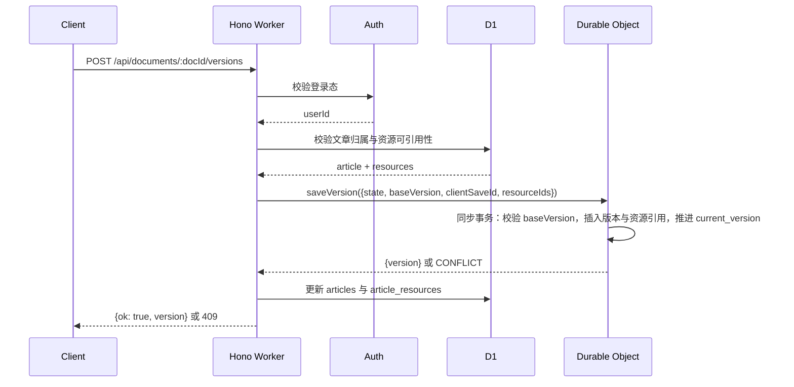
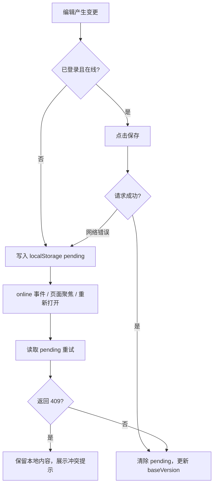

# Editor 规格说明（SPEC）

- 状态：Draft
- 版本：0.1
- 更新日期：2026-11-25
- 关联文档：[README.md](./README.md)

本文是本项目的**契约文档**：定义范围、数据模型、接口、并发规则和验收标准。实现细节和本地开发方式见 README。文中 `MUST` / `MUST NOT` / `SHOULD` / `MAY` 按 RFC 2119 理解。

## 1. 目标

1. 基于 Lexical 的富文本编辑：标题、列表、引用、代码、链接、表格、图片、Mermaid 图等。
2. 同时支持两种编辑模式：
   - **临时编辑**：无需登录，内容只存浏览器 `localStorage`。
   - **联网编辑**：需要登录，文章元信息写 D1，版本内容写 Durable Object 的 SQLite。
3. 手动保存生成**不可变版本**，支持版本列表、只读预览和恢复。
4. 断网时继续编辑，改动缓存在本地，恢复网络后提交；冲突时不得静默覆盖。
5. 上传的资源归属到用户资源库，文章通过稳定的 `resourceId` 引用资源。

## 2. 非目标（MVP 明确不做）

- 实时协同编辑（Yjs / CRDT）。
- 自动保存定时器；MVP 只做手动保存。
- 版本内容的结构化 diff。
- 文章公开分享、评论、多人协作权限。
- 账号体系本身；登录能力完全复用 `@ebichu-cc/auth`。
- 资源库的高级管理能力（标签、文件夹、配额页面）；MVP 只做上传、列表、引用、软删除。
- 跨设备离线冲突自动合并。
- 公共资源库、资源分享入口和审核流程；MVP 只预留 `visibility` 字段。
- MVP 不使用 Durable Object 的 WebSocket；保存与冲突处理全部通过 HTTP 完成。现有 echo demo 不属于本规格。

## 3. 术语

| 术语 | 定义 |
| --- | --- |
| `docId` | 文章唯一标识。所有接口、查询参数和前端状态统一使用这个名字，不再使用 `article` 作为参数名。 |
| 临时文档 | 未登录时编辑的本地草稿，只存在于 `localStorage`。 |
| 联网文档 | 已登录并持久化到 D1 + DO 的文章。 |
| 版本 | 一次成功保存生成的不可变快照，包含 Lexical EditorState JSON 和纯文本。 |
| `baseVersion` | 本次保存所基于的版本号，用作乐观锁。 |
| 资源 | 用户上传到个人资源库的文件，存储在 R2，元数据在 D1。 |
| `resourceId` | 资源唯一标识。文章应引用它，而不是直接依赖可变的 URL。 |
| pending 保存 | 联网文档在离线或请求失败时暂存在本地的待提交保存。 |

## 4. 功能需求

### FR-1 编辑

- **FR-1.1** 编辑器 MUST 支持当前已接入的 Lexical 能力：富文本格式、列表、引用、代码、链接、表格、图片和 Mermaid 图。
- **FR-1.2** 未登录用户 MUST 能使用临时编辑；临时文档 MUST NOT 写入 D1、DO 或 R2。
- **FR-1.3** 联网编辑 MUST 要求登录态。未登录访问联网文档或写接口时返回 `401`，前端引导登录。
- **FR-1.4** 文章标题 MUST 可编辑，并持久化到 D1。MVP 中标题变更不进入版本历史。
- **FR-1.5** 图片/附件 MUST 通过资源引用嵌入文章；资源 MUST 是当前用户有权引用的资源（自己的，或标记为公共/共享的资源）。
- **FR-1.6** 编辑器有未保存修改时 MUST 显示明确的“未保存”状态；保存成功后清除，保存失败时保持。
- **FR-1.7** `?embed` 仅作为当前演示/嵌入模式的兼容行为；是否作为正式产品能力待定（见开放问题）。

### FR-2 保存

- **FR-2.1** MVP MUST 只通过显式“保存”按钮创建版本，不启用自动保存。
- **FR-2.2** 每次成功保存 MUST 追加一个新版本，不修改或删除旧版本。
- **FR-2.3** 客户端 MUST 为每次保存生成 `clientSaveId`，服务端 MUST 保证同一 `(docId, clientSaveId)` 只创建一个版本；重试时返回第一次保存的结果。
- **FR-2.4** 保存请求 MUST 携带 `baseVersion`。若与服务端当前版本不一致，服务端 MUST 返回 `409 CONFLICT` 和当前版本号，且 MUST NOT 写入新版本。
- **FR-2.5** 内容与当前版本完全相同时，客户端 SHOULD 跳过请求并提示“无修改”；服务端仍可按 FR-2.2 创建版本。
- **FR-2.6** 保存过程中按钮 MUST 进入 loading 状态并防止重复提交；客户端 MUST 丢弃过期的保存响应。
- **FR-2.7** 保存失败时 MUST 保留本地内容，并提示可重试；不得清空 dirty 状态。

### FR-3 版本历史

- **FR-3.1** 版本列表 MUST 只返回元信息（版本号、时间、作者、label、字数/摘要），MUST NOT 返回完整 `state`。
- **FR-3.2** 版本列表 MUST 支持分页，默认 20 条，最大 100 条。
- **FR-3.3** 查看历史版本 MUST 以只读方式渲染，不得污染当前编辑状态。
- **FR-3.4** 恢复历史版本 MUST 以旧版本内容创建一个**新版本**，MUST NOT 覆盖或删除旧版本。

### FR-4 临时编辑与离线

- **FR-4.1** 临时文档 MUST 在编辑后写入 `localStorage`，刷新页面后恢复。
- **FR-4.2** 临时文档 MUST 在保存/刷新/页面隐藏时落盘；`localStorage` 写入失败时 MUST 提示用户，不得静默丢失。
- **FR-4.3** 联网文档保存时若断网或请求发生网络错误，客户端 MUST 将 `{state, plainText, baseVersion, clientSaveId, resourceIds}` 写入本地 pending 队列，并提示“已保存到本地，待联网提交”。
- **FR-4.4** 客户端 MUST 在 `online` 事件、页面重新聚焦或重新打开文档时尝试提交 pending 保存。
- **FR-4.5** pending 提交遇到 `409` 时 MUST 保留本地内容并展示冲突提示，MUST NOT 自动覆盖服务端新版本。
- **FR-4.6** pending 保存成功后 MUST 清除本地记录并更新 `baseVersion`；失败时 MUST 保留。
- **FR-4.7** 登录后 MAY 提供“将临时草稿保存为在线文章”的显式操作；MVP 可后置。

### FR-5 资源库

- **FR-5.1** 资源上传 MUST 要求登录；资源 MUST 归属当前用户，`owner_id` 只能由服务端从登录态写入。
- **FR-5.2** 用户资源列表 MUST 只返回当前用户的资源，支持分页。
- **FR-5.3** 同一用户重复上传相同内容（SHA-256 相同）时 SHOULD 复用已有资源，不重复写入 R2。
- **FR-5.4** 资源 MUST 有服务端生成的 `resourceId` 和 R2 `object_key`；客户端传入的前缀/路径 MUST NOT 直接作为最终 key。
- **FR-5.5** 文章保存时 MUST 校验每个 `resourceId` 存在且当前用户有权引用：资源属于作者，或资源的可见性允许该用户引用（例如 `public`）。不满足时返回 `403`，且不得创建版本。
- **FR-5.6** 删除资源 MUST 先软删除（从资源库列表隐藏）；仅当没有任何版本引用该资源时才允许物理删除。
- **FR-5.7** 历史版本引用的资源 MUST 仍然可读，即使该资源已从资源库软删除。
- **FR-5.8** 恢复历史版本时 MAY 继续引用该版本已存在的软删除资源；软删除 MUST NOT 使历史版本或恢复流程不可用。
- **FR-5.9** 资源可见性 MUST 至少区分 `private`（仅 owner）和 `public`（可被引用/读取）；公共资源的创建入口不在 MVP 范围。

### FR-6 文章管理

- **FR-6.1** 登录用户可以创建文章；`docId` MUST 由服务端生成，不能由客户端指定。
- **FR-6.2** 登录用户可以列出自己的文章，按 `updated_at` 倒序分页。
- **FR-6.3** 只有作者可以读取和修改联网文章；MVP 默认文章私有（见开放问题）。
- **FR-6.4** D1 保存文章元信息，DO 保存版本；二者职责不得混用。

### FR-7 登录态

- **FR-7.1** 编辑器 MUST 复用 `@ebichu-cc/auth` 和共享 `auth` D1，不实现自己的登录/注册表单。
- **FR-7.2** 未登录时 MUST 显示登录入口；点击后跳转 `https://login.ebichu.cc/login?return_to=<当前页面>`。
- **FR-7.3** 登录后 MUST 以 `avatarFor(user.email)` 渲染圆形头像，展示其大写首字母，并在下拉菜单中显示邮箱。
- **FR-7.4** 下拉菜单 MUST 提供退出登录；退出时撤销当前 session 并清理共享 Cookie。

## 5. 非功能需求

- **NFR-1 性能**：正常网络下，单次保存的目标 P95 延迟 < 1.5s；版本列表请求不传输完整 EditorState。
- **NFR-2 容量**：单个 EditorState MUST ≤ 512 KiB；`plainText` MUST ≤ 256 KiB；标题 MUST ≤ 200 字符；单次请求资源引用数 SHOULD ≤ 200；上传文件 MUST ≤ 10 MiB（可配置）。
- **NFR-3 一致性**：同一文档的版本写入 MUST 在 DO 内串行化；版本号 MUST 单调递增且唯一。
- **NFR-4 安全**：所有写接口 MUST 校验登录态和资源可引用性；`author_id`、`owner_id` MUST NOT 信任客户端传入值。
- **NFR-5 可用性**：D1 元信息读取与 DO 版本读取应能独立失败并返回明确错误；不得把 D1 的暂时不一致当作版本数据损坏。
- **NFR-6 兼容性**：支持当前主流 Chromium、Firefox、Safari 桌面版；移动端只保证基本可用。

## 6. 数据模型

### 6.1 存储职责

| 存储 | 内容 | 权威性 |
| --- | --- | --- |
| D1 `articles` | 文章 id、标题、作者、当前版本号（冗余索引）、时间戳、状态 | 文章元信息权威 |
| D1 `resources` | 用户资源库元数据（R2 key、文件名、MIME、大小、哈希、状态） | 资源元信息权威 |
| D1 `article_resources` | 文章与资源的关联（含首次/最后出现的版本） | 关联关系索引 |
| D1 `auth`（共享） | `users` / `sessions`，由 `@ebichu-cc/auth` 管理 | 登录态权威 |
| DO SQLite `documents` | 每个文档的当前版本指针 | 版本号权威 |
| DO SQLite `document_versions` | 不可变版本快照、纯文本、`clientSaveId` | 版本内容权威 |
| DO SQLite `version_resources` | 每个版本引用的资源 id | 资源引用权威 |
| R2 `R2_MEDIA` | 资源文件字节 | 文件内容权威 |

D1 的 `articles.current_version` 是便于列表查询的冗余字段，**DO 是版本号的真相源**。两者不一致时以 DO 为准，并允许异步修复。

### 6.2 D1 Schema

```sql
CREATE TABLE IF NOT EXISTS articles (
  doc_id          TEXT PRIMARY KEY,
  title           TEXT NOT NULL DEFAULT '',
  author_id       TEXT NOT NULL,
  current_version INTEGER NOT NULL DEFAULT 0,
  status          TEXT NOT NULL DEFAULT 'active',
  created_at      INTEGER NOT NULL,
  updated_at      INTEGER NOT NULL
);

CREATE INDEX IF NOT EXISTS idx_articles_author
  ON articles (author_id, updated_at DESC);

CREATE TABLE IF NOT EXISTS resources (
  resource_id TEXT PRIMARY KEY,
  owner_id    TEXT NOT NULL,
  object_key  TEXT NOT NULL,
  filename    TEXT NOT NULL,
  mime        TEXT NOT NULL,
  size        INTEGER NOT NULL,
  sha256      TEXT NOT NULL,
  visibility  TEXT NOT NULL DEFAULT 'private', -- private | public
  status      TEXT NOT NULL DEFAULT 'active',
  created_at  INTEGER NOT NULL,
  UNIQUE (owner_id, sha256)
);

CREATE INDEX IF NOT EXISTS idx_resources_owner
  ON resources (owner_id, created_at DESC);

CREATE TABLE IF NOT EXISTS article_resources (
  doc_id             TEXT NOT NULL,
  resource_id        TEXT NOT NULL,
  first_seen_version INTEGER NOT NULL,
  last_seen_version  INTEGER NOT NULL,
  PRIMARY KEY (doc_id, resource_id)
);

CREATE INDEX IF NOT EXISTS idx_article_resources_resource
  ON article_resources (resource_id);
```

`article_resources` 记录文章历史中出现过的资源并集；即使某资源在最新版本中已被移除，只要旧版本还引用它，记录就 MUST 保留。

### 6.3 Durable Object Schema

```sql
CREATE TABLE IF NOT EXISTS documents (
  id              TEXT PRIMARY KEY,
  current_version INTEGER NOT NULL DEFAULT 0,
  created_at      INTEGER NOT NULL,
  updated_at      INTEGER NOT NULL
);

CREATE TABLE IF NOT EXISTS document_versions (
  id             TEXT PRIMARY KEY,
  document_id    TEXT NOT NULL,
  version        INTEGER NOT NULL,
  base_version   INTEGER,
  state          TEXT NOT NULL,
  plain_text     TEXT NOT NULL DEFAULT '',
  state_sha256   TEXT NOT NULL,
  label          TEXT,
  author_id      TEXT,
  client_save_id TEXT,
  created_at     INTEGER NOT NULL,
  UNIQUE (document_id, version),
  UNIQUE (document_id, client_save_id)
);

CREATE INDEX IF NOT EXISTS idx_versions_doc
  ON document_versions (document_id, version DESC);

CREATE TABLE IF NOT EXISTS version_resources (
  document_id TEXT NOT NULL,
  version     INTEGER NOT NULL,
  resource_id TEXT NOT NULL,
  PRIMARY KEY (document_id, version, resource_id)
);
```

SQLite 中 `UNIQUE` 允许多个 `NULL`，因此历史数据没有 `client_save_id` 时不冲突；新写入的版本 SHOULD 始终带该字段。

### 6.4 数据不变量

1. `document_versions` 只追加，不更新、不删除（GC 除外，且 GC 不改变已有版本号语义）。
2. 同一文档的 `version` 从 1 开始连续递增，且 `(document_id, version)` 唯一。
3. `documents.current_version` 等于该文档最大版本号。
4. `restore` 生成新版本，旧版本保持不变。
5. 同一 `(document_id, client_save_id)` 最多对应一个版本。
6. `author_id` 来自登录态，`owner_id` 来自登录态，二者不得由请求体覆盖。
7. 文章版本中引用的资源必须是当前作者有权引用的资源（自己的，或可见性为 `public`/共享的）。
8. 已被任何版本引用的资源不得物理删除。

### 6.5 一致性策略

- 版本保存以 DO 同步事务为提交点。DO 成功后，Worker 再更新 D1 的 `current_version`、`updated_at` 和 `article_resources`。
- 若 D1 更新失败，保存仍 SHOULD 返回成功（版本已持久化），并记录修复任务；下次读取文章时可按 DO 的当前版本修复 D1。
- 文章列表允许短暂使用 D1 的 `current_version`；打开单篇文章时应以 DO 返回的版本号为准。

## 7. HTTP API

### 7.1 通用约定

- 所有 `/api/*` 返回 JSON。
- 错误统一为：

  ```json
  { "ok": false, "code": "CONFLICT", "message": "baseVersion is stale" }
  ```

- 成功响应可带 `ok: true`，也可直接返回资源对象；同一接口内保持稳定。
- 时间统一为 Unix 毫秒时间戳。
- 分页使用 `limit` + `before`；`before` 为上一页最后一项的排序列值（版本用 `version`，文章/资源用 `updated_at` / `created_at`）。

### 7.2 认证

- 登录能力复用 `@ebichu-cc/auth`，会话数据放在共享 D1 `auth`（绑定名 `AUTH_DB`）。
- 编辑器只读登录态，不写登录 Cookie；登录、注册、写入 Cookie 仍由 `login.ebichu.cc` 负责。
- Worker 通过 `@ebichu-cc/auth` + `@ebichu-cc/auth/d1` 构造 `Auth`，读取共享会话 Cookie：
  - 生产：`__Secure-ebichu_session`，`Domain=ebichu.cc`。
  - 本地开发：`ebichu_session`，host-scoped。
- 当前用户契约：

  ```ts
  interface AuthUser {
    id: string
    email: string
    createdAt: number
  }
  ```

- 受保护接口未登录时返回 `401 UNAUTHORIZED`。
- 本地开发时，editor 与 login worker 通过 `persistState` 共享 `D:\git\.ebichu-state`；登录入口指向 `http://<当前主机>:4321/login`，login worker 允许 localhost 的 `return_to`。
- 前端未登录时跳转到 `https://login.ebichu.cc/login?return_to=<当前页面>`。

### 7.3 端点

| 方法 | 路径 | 认证 | 说明 |
| --- | --- | --- | --- |
| `GET` | `/api/me` | 按 Cookie | 当前用户；未登录返回 401 |
| `POST` | `/api/logout` | 按 Cookie + Origin | 撤销当前 session 并清理 Cookie |
| `POST` | `/api/documents` | 是 | 创建文章，返回 `docId` |
| `GET` | `/api/documents` | 是 | 列出当前用户的文章 |
| `GET` | `/api/documents/:docId` | 是 | 文章元信息 + 当前版本号 |
| `PATCH` | `/api/documents/:docId` | 是 | 修改标题 |
| `GET` | `/api/documents/:docId/versions` | 是 | 版本列表（不含 `state`） |
| `GET` | `/api/documents/:docId/versions/:version` | 是 | 单个版本完整内容 |
| `POST` | `/api/documents/:docId/versions` | 是 | 保存新版本 |
| `POST` | `/api/documents/:docId/versions/:version/restore` | 是 | 以旧版本为基础生成新版本 |
| `POST` | `/api/resources` | 是 | 上传资源（multipart） |
| `GET` | `/api/resources` | 是 | 当前用户的资源库 |
| `GET` | `/api/resources/:resourceId/content` | 否 | 旧图片节点兼容端点，公开读取 |
| `DELETE` | `/api/resources/:resourceId` | 是 | 软删除资源 |

> 图片渲染统一使用资源返回的 `key` + `url`：线上为 `https://media.ebichu.cc/<key>`，本地客户端换成 `/media?key=<key>`。`/media` 不做鉴权。

创建文章成功：

```json
{
  "ok": true,
  "document": {
    "docId": "doc_01J...",
    "title": "",
    "currentVersion": 0,
    "createdAt": 1764123456789
  }
}
```

### 7.4 保存版本

请求：

```http
POST /api/documents/:docId/versions
Content-Type: application/json
```

```json
{
  "state": "{\"root\":{...}}",
  "plainText": "Hello world",
  "baseVersion": 3,
  "clientSaveId": "0f6c2f1e-6a4b-4d4e-9b8a-3f0f3a1b2c3d",
  "resourceIds": ["res_01J...", "res_01K..."],
  "label": null
}
```

成功：

```json
{
  "ok": true,
  "version": 4,
  "createdAt": 1764123456789,
  "replayed": false
}
```

- `replayed: true` 表示命中 `clientSaveId` 幂等重放，未创建新版本。

冲突：

```json
{
  "ok": false,
  "code": "CONFLICT",
  "message": "baseVersion is stale",
  "currentVersion": 5
}
```

幂等：

- 相同 `clientSaveId` 重试时 MUST 返回第一次成功的结果，MUST NOT 创建新版本。
- 相同 `clientSaveId` 但请求体不同时，SHOULD 返回 `409 CONFLICT` 或 `400 VALIDATION_ERROR`，不得覆盖已有版本。

### 7.5 资源上传

```http
POST /api/resources
Content-Type: multipart/form-data

file=<binary>
```

成功：

```json
{
  "ok": true,
  "resource": {
    "resourceId": "res_01J...",
    "key": "u/<ownerId>/<sha256>.png",
    "filename": "diagram.png",
    "mime": "image/png",
    "size": 123456,
    "visibility": "private",
    "url": "https://media.ebichu.cc/u/<ownerId>/<sha256>.png",
    "createdAt": 1764123456789
  },
  "deduped": false
}
```

- MIME 允许列表：`image/jpeg`、`image/png`、`image/gif`、`image/webp`。MVP MUST NOT 接受 SVG 或 HTML。
- R2 key 规则：`u/<ownerId>/<sha256>.<ext>`，由服务端生成。
- 去重 MUST 使用完整文件的 SHA-256。现有 `src/server/utils/hash.ts` 的 `calcEdgeHash` 对大文件只计算首尾各 1 MiB，不能用于资源去重或内容寻址，需要新增完整的流式哈希实现。
- 上传默认 `visibility = 'private'`；公共资源由后续的管理/分享能力产生，MVP 不提供创建入口。
- 资源返回 `key` 和 `url`；客户端 MUST 以 `key` 作为本地 `/media` 的查询参数，以 `url` 作为线上地址。
- `/media` 不做鉴权，可读取 `R2_MEDIA` 中任意 key；这是当前的简化取舍。

资源列表：

```json
{
  "ok": true,
  "resources": [
    {
      "resourceId": "res_01J...",
      "key": "u/<ownerId>/<sha256>.png",
      "filename": "diagram.png",
      "mime": "image/png",
      "size": 123456,
      "visibility": "private",
      "url": "https://media.ebichu.cc/u/<ownerId>/<sha256>.png",
      "createdAt": 1764123456789
    }
  ],
  "nextBefore": null
}
```

`nextBefore` 为下一页游标；为 `null` 表示没有更多数据。

### 7.6 错误码

| HTTP | code | 场景 |
| --- | --- | --- |
| 400 | `VALIDATION_ERROR` | JSON 不合法、字段缺失、超限 |
| 401 | `UNAUTHORIZED` | 未登录或登录态失效 |
| 403 | `FORBIDDEN` | 非作者、引用无权使用的资源、资源越权 |
| 404 | `NOT_FOUND` | 文章/版本/资源不存在 |
| 409 | `CONFLICT` | `baseVersion` 过期、`clientSaveId` 冲突 |
| 413 | `PAYLOAD_TOO_LARGE` | `state`、文件等超过上限 |
| 500 | `INTERNAL` | 未预期错误 |

## 8. 关键流程

### 8.1 在线保存



规则：

- DO 事务内 MUST NOT 有 `await`；压缩、序列化、校验放在事务外。
- `UNIQUE (document_id, version)` 和 `UNIQUE (document_id, client_save_id)` 是并发下的最后防线。
- 冲突返回结构化结果，不依赖跨 RPC 的自定义错误类型。
- 服务端 SHOULD 计算完整 `state` 的 SHA-256 写入 `state_sha256`，用于审计和辅助去重；它不替代 `clientSaveId` 的幂等语义。

### 8.2 离线与重连



### 8.3 恢复版本

1. 客户端读取目标版本完整 `state`。
2. 调用 `POST /api/documents/:docId/versions/:version/restore`，请求携带新的 `clientSaveId` 和当前 `baseVersion`。
3. 服务端读取旧版本内容，以新版本号追加，不修改旧行。
4. 旧版本引用的软删除资源仍然可读，恢复流程 MUST NOT 因资源已软删除而失败（见 FR-5.8）。
5. 返回新版本号，客户端刷新版本列表并更新 `baseVersion`。

### 8.4 资源上传与引用

1. 客户端上传文件到 `POST /api/resources`。
2. 服务端校验登录态、大小、MIME，计算 SHA-256，按 `(owner_id, sha256)` 去重。
3. 文件写 R2，元数据写 D1 `resources`。
4. 客户端把返回的 `resourceId` 写入 Lexical 节点，同时缓存 `url` 用于渲染。
5. 保存文章时把 `resourceIds` 一并提交，服务端校验资源可引用性并写入 `version_resources` 与 `article_resources`。

## 9. 客户端行为

### 9.1 Dirty 状态

- 编辑器 MUST 保存“最后一次成功保存/加载的 EditorState 快照”。
- 当前 EditorState 与快照不同即进入 dirty 状态，显示“未保存”标识。
- 保存成功、恢复成功、切换文档后 MUST 清除 dirty。
- 保存失败、冲突、进入只读历史预览时不得错误清除 dirty。

### 9.2 本地存储键

| Key | 内容 |
| --- | --- |
| `editor:draft:v1` | 临时文档的 EditorState JSON 和更新时间 |
| `editor:pending:v1:<docId>` | 联网文档的待提交保存：`state`、`plainText`、`baseVersion`、`clientSaveId`、`resourceIds`、`savedAt` |

- 临时草稿和 pending 保存 MUST 使用不同 key。
- 读取到损坏 JSON 时 MUST 容错：提示并允许清空，不得导致页面白屏。

### 9.3 保存交互

- 保存按钮在请求中 MUST 禁用。
- 客户端 MUST 维护递增的请求序号，只接受最新请求的响应。
- `409` UX MUST 提供：查看最新版本 / 基于最新版本继续（需要用户确认）/ 放弃本地修改。
- 页面存在 dirty 或 pending 时，`beforeunload` SHOULD 提示（浏览器允许时）。

### 9.4 历史预览

- 历史版本 MUST 使用独立的只读编辑器实例或 `setEditable(false)`，不得复用可编辑实例的本地状态。
- 退出预览后 MUST 恢复当前编辑内容与 dirty 状态。

## 10. 安全与隐私

- 所有写接口 MUST 经过 `@ebichu-cc/auth`；`author_id` / `owner_id` 只从登录态获取。
- 文章读取 MUST 校验作者权限；图片/资源文件通过公开 `/media` 或 CDN 读取，不做鉴权。`visibility` 目前仅用于资源库展示。
- HTML/Markdown 导入与粘贴 MUST 做清洗，禁止脚本、事件属性和危险 URL（`javascript:` 等）。
- Mermaid 图渲染 SHOULD 禁用或限制可执行内容；不得直接插入未清洗的 HTML。
- 资源上传 MUST 校验 MIME 与大小；不得信任客户端 `Content-Type` 和文件名后缀。
- 密钥 MUST 只存在于 Worker 环境变量/Secret，不得进入客户端 bundle。
- 公开分享能力启用前，必须重新评审资源 URL、缓存头和越权读取。

## 11. 可观测性与运维

- 记录结构化日志：保存成功/冲突/失败、版本号、`docId`、耗时；不得记录完整文章内容。
- 监控：DO 存储大小、版本增长率、R2 用量、409 比例、pending 重试失败率。
- D1 迁移使用 `wrangler d1 migrations`；DO schema 使用 `PRAGMA user_version` 做顺序迁移。
- 定期任务（`setAlarm`）可执行：D1 `current_version` 修复、资源 GC、过期 pending 提示。
- 提供文章导出（至少导出当前版本 EditorState JSON）作为后续备份能力。

## 12. 测试与验收

### 12.1 单元/集成测试重点

- 首次保存、连续保存、`baseVersion` 冲突、重复 `clientSaveId`。
- 恢复旧版本生成新版本。
- 版本分页边界（空列表、正好一页、跨页）。
- 资源可引用性/可见性校验、去重、软删除与历史版本可读。
- D1 更新失败时 DO 版本仍成功、后续可修复。
- 非法 JSON、超长 `state`、非法 MIME。

### 12.2 验收清单

- [ ] 登录后从上头像菜单进入 `/resources`，能看到资源 id、上传时间、大小，并可打开资源链接；分页可用。
- [ ] 未登录时显示“登录”，点击后跳到 `login.ebichu.cc/login?return_to=...`。
- [ ] 登录后显示圆形头像（邮箱首字母大写）和邮箱；下拉菜单可以退出登录。
- [ ] 未登录时可以临时编辑；刷新后内容仍在；Network 面板没有写请求。
- [ ] 登录后创建文章，手动保存生成 v1；再次保存生成 v2。
- [ ] 编辑后显示“未保存”；保存成功后标识消失。
- [ ] 两个标签页基于同一版本保存，后保存者收到 `409`，服务端只有一个新版本。
- [ ] 断网保存进入 pending；恢复网络后自动提交成功。
- [ ] 断网期间服务端已有新版本，重连提交返回 `409` 且本地内容不丢。
- [ ] 版本列表不返回 `state`；打开单个版本才拉取完整内容。
- [ ] 恢复 v1 后生成新版本，v1 内容不变。
- [ ] 上传资源后只出现在当前用户资源库；重复上传命中复用。
- [ ] 引用他人**私有** `resourceId` 保存返回 `403`，不产生版本；引用 `public` 资源保存成功。
- [ ] 软删除资源后，历史版本仍能显示该资源。
- [ ] 未登录访问任何写接口返回 `401`。

## 13. 里程碑

| 里程碑 | 范围 | 完成定义 |
| --- | --- | --- |
| M0 | 规格与契约 | 本 SPEC 通过评审 |
| M1 | 认证 + 文章元信息 | `@ebichu-cc/auth` 接入；D1 `articles`；创建/列表/读取/改标题 |
| M2 | 版本持久化 | DO schema、`saveVersion`、手动保存、dirty 状态 |
| M3 | 版本历史 | 列表分页、只读预览、恢复 |
| M4 | 离线队列 | pending 存储、重连提交、409 UX |
| M5 | 资源库 | 上传、去重、列表、软删除、文章引用 |
| M6 | 后续能力 | 自动保存、WebSocket 广播、协同编辑、公开分享 |

M1–M3 是联网编辑的最小闭环；M4、M5 可按实际优先级并行。

## 14. 开放问题

1. 文章是否始终私有？公开阅读/分享链接的产品形态未定，会影响文章权限与资源缓存策略。
2. 共享本地状态目录（`D:\git\.ebichu-state`）在 schema 变更或切换分支时的清理策略。
3. 标题是否需要在版本历史中留痕？MVP 暂不记录。
4. 资源是走同源 `/api/resources/:id/content` 还是公开自定义域名？前者便于鉴权，后者便于 CDN。
5. 资源物理删除的宽限期与 GC 频率。
6. 公共/共享资源的创建、审核、配额和可见性模型（`public`、组织内共享等）。
7. Mermaid 图的数据存储、渲染环境和安全边界（是否允许外部链接、脚本）。
8. D1 与 DO 的 `current_version` 修复策略：读时修复还是定时任务修复。
9. 自动保存的频率与“何时算一个版本”的规则。
10. `?embed` 是否作为正式能力保留。

## 附录 A：命名约定

- 文章标识统一为 `docId`；禁止新增 `article` / `articleId` 作为查询参数或字段名。
- 资源标识统一为 `resourceId`。
- 版本字段统一为 `version`、`baseVersion`、`currentVersion`。
- 本地待提交记录统一为 `pending`。

## 附录 B：与当前代码的差异

- `src/server/EditorServerDurable.ts` 已加入 SQLite schema、`PRAGMA user_version` 迁移和 `saveVersion` 骨架；HTTP/RPC 接入与客户端保存流程仍待实现。WebSocket echo 仍在，但不属于 MVP 契约。
- `migrations/0001_init.sql` 已添加 D1 表结构；资源接口已开始使用 `EDITOR_DB`。
- `src/client/editor/hooks/usePersistence.ts` 目前只用 `localStorage` 保存单个 `EDITOR_STATE`。
- `wrangler.jsonc` 已声明 D1 `EDITOR_DB`、共享 `AUTH_DB`、R2 `R2_MEDIA` 和 DO；`EDITOR_DB` 已用于资源元数据。
- `src/server/index.tsx` 的 WebSocket 查询参数目前叫 `article`，需统一为 `docId`。
- 资源上传已改用完整 SHA-256（`sha256Hex`）；`calcEdgeHash` 不再用于上传去重。
- `PUT /image` 已改为匿名上传到 `anonymous/image/`；`GET /media` 不做鉴权，并保留旧匿名/历史资源可读。
- 登录用户走 `POST /api/resources`；`GET /api/resources`、`DELETE /api/resources/:resourceId` 已实现，`ImageProvider` 已按登录态分流。
- 图片 URL 统一为 `https://media.ebichu.cc/<key>`，本地由 `ImageNode` 换成 `/media?key=<key>`。
- 保留公开的 `GET /api/resources/:resourceId/content`，仅供早期 `/api/resources/.../content` 图片节点兼容使用。
- `@ebichu-cc/auth` 已作为 devDependency 安装；`src/server/auth.ts` 已通过共享 `AUTH_DB` 接入登录态，`/api/me` 与 `/api/logout` 已实现。
- `src/client/components/AuthProvider.tsx` / `AuthMenu.tsx` 已实现登录态共享、登录跳转、头像和退出登录。
